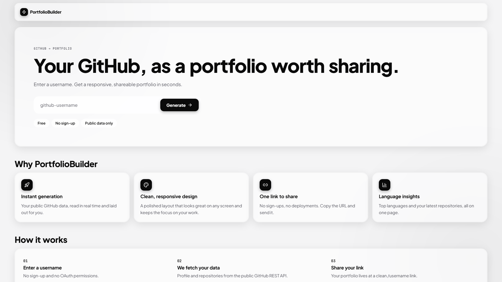
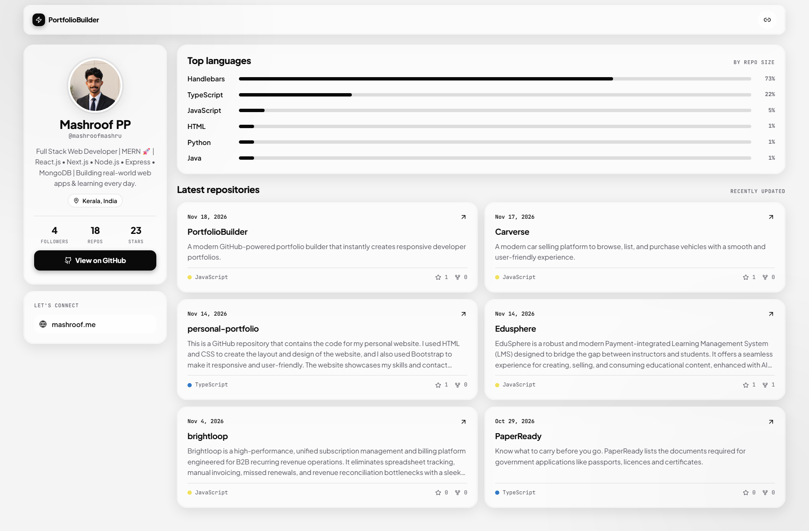

# PortfolioBuilder ⚡





**Turn any GitHub profile into a clean, shareable portfolio in seconds.**

[](https://portfolio-builder-rho-gules.vercel.app)

  

🔗 **Live site:** [https://portfolio-builder-rho-gules.vercel.app](https://portfolio-builder-rho-gules.vercel.app)

Try it with any GitHub username, for example [`/torvalds`](https://portfolio-builder-rho-gules.vercel.app/torvalds).

## 📖 About

Stop building portfolios from scratch. Enter a GitHub username and **PortfolioBuilder** fetches your public data, ranks your languages, picks out your latest repositories, and lays everything out as a responsive portfolio you can share with a single link. No sign-up, no OAuth and no backend.

## ✨ Features

- **🚀 Instant generation**: Reads your public GitHub profile and repositories in real time. No OAuth or sign-ups required.
- **🔗 Clean, shareable URLs**: Every portfolio lives at `/<username>`. Copy the link and send it to recruiters or friends.
- **📊 Language insights**: Your top languages, shown as proportional bars based on repository size.
- **🆕 Latest repositories**: Your six most recently updated repositories, with stars, forks, language and last-update date.
- **👤 Profile at a glance**: Avatar, bio, location, followers, repository count and total stars, plus links to your website, LinkedIn or X when they can be found.
- **🎨 Glassmorphism design**: A black-and-white frosted-glass interface that is fully responsive from phones to wide desktops.
- **♿ Accessible**: Keyboard-friendly, visible focus states, labelled controls and reduced-motion support.
- **🛟 Friendly errors**: Clear messages for unknown usernames, GitHub rate limits and network problems.

## 🛠️ Tech Stack

- **Framework**: [React 19](https://react.dev/) + [Vite 8](https://vitejs.dev/)
- **Styling**: Vanilla CSS with design tokens and glassmorphism techniques
- **Icons**: [Lucide React](https://lucide.dev/)
- **Data source**: [GitHub REST API](https://docs.github.com/en/rest)
- **Hosting**: [Vercel](https://vercel.com/) (single-page app rewrites in `vercel.json`)

## 🚀 Getting Started

Follow these steps to run the project locally.

### Prerequisites

- Node.js 20.19+ (or 22.12+)
- npm

### Installation

1. Clone the repository:
   ```bash
   git clone https://github.com/mashroofmashru/PortfolioBuilder.git
   cd PortfolioBuilder
   ```

2. Install dependencies:
   ```bash
   npm install
   ```

3. Start the development server:
   ```bash
   npm run dev
   ```

4. Open `http://localhost:5173`, or go straight to a portfolio such as `http://localhost:5173/torvalds`.

### Scripts

| Command           | Description                          |
| ----------------- | ------------------------------------ |
| `npm run dev`     | Start the Vite dev server            |
| `npm run build`   | Create a production build in `dist/` |
| `npm run preview` | Preview the production build locally |
| `npm run lint`    | Run ESLint                           |

## 📝 Usage

1. **Generate**: Open the home page and enter a valid GitHub username (for example `torvalds`).
2. **Explore**: Browse the profile card, language breakdown and latest repositories.
3. **Share**: Click the link icon in the header to copy the portfolio URL, or copy it from the address bar.

> **Note:** The app calls the GitHub API without authentication, which allows about 60 requests per hour per IP address. If you hit the limit, wait a while and try again.

## 📂 Project Structure

```text
src/
├── components/              # UI (presentational)
│   ├── Contact.jsx          # Website / LinkedIn / X links
│   ├── Hero.jsx             # Profile card: avatar, bio and stats
│   ├── Icons.jsx            # Inline brand icons (GitHub, LinkedIn, X)
│   ├── Landing.jsx          # Home page with the username form
│   ├── Portfolio.jsx        # The generated portfolio page (layout + share toast)
│   ├── PortfolioHeader.jsx  # Top bar with logo and share button
│   ├── ProjectCard.jsx      # A single repository card
│   ├── Projects.jsx         # Latest repositories grid
│   ├── Skills.jsx           # Top languages with usage bars
│   └── StatusViews.jsx      # Loading and error screens
├── hooks/                   # React state and side effects
│   ├── useDocumentTitle.js  # Sets the page title
│   ├── usePortfolio.js      # Username <-> URL sync, loading, errors, data
│   └── useToast.js          # Self-clearing toast message
├── lib/                     # Pure logic, no React
│   ├── format.js            # Number and date formatting
│   ├── github.js            # GitHub API calls, caching, error messages
│   ├── languageColors.js    # Colours for common languages
│   ├── portfolio.js         # Raw API data -> display data
│   └── routing.js           # /<username> URL helpers and validation
├── App.jsx                  # Picks the screen: landing, loading, error or portfolio
├── index.css                # Design tokens and all styles
└── main.jsx                 # React entry point
docs/
├── screenshot.png           # README screenshot: home page
└── portfolio.png            # README screenshot: generated portfolio
```

## ☁️ Deployment

The project is deployed on Vercel. `vercel.json` rewrites every path to `index.html`, so URLs like `/username` work on refresh and when shared. To deploy your own copy, import the repository into Vercel and keep the default Vite settings (build command `npm run build`, output directory `dist`).
